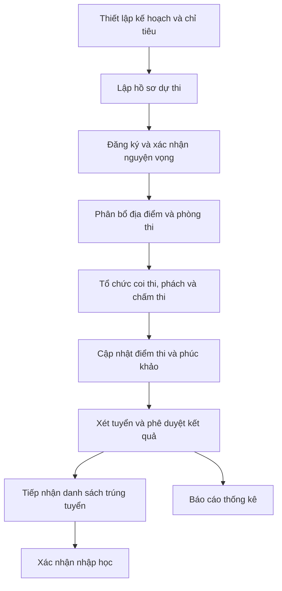

# Software Requirements Specification (SRS)
## Hệ thống quản lý tuyển sinh lớp 10

**Tài liệu đặc tả yêu cầu phần mềm**

| Thuộc tính | Thông tin |
|---|---|
| Nguồn yêu cầu | Báo cáo phân tích và thiết kế hệ thống – Nhóm Một Nhà, 21/10/2026 |
| Phạm vi | Hồ sơ, nguyện vọng, tổ chức thi, chấm thi, xét tuyển và nhập học |
| Trạng thái | Đặc tả tổng hợp; chưa có biên bản phê duyệt yêu cầu |

> **Trạng thái:** Draft. Yêu cầu được tổng hợp từ báo cáo phân tích và thiết kế của nhóm; chưa có xác nhận phê duyệt từ đơn vị nghiệp vụ.

## 1. Giới thiệu

### 1.1. Mục đích

SRS xác định các chức năng, quy tắc xử lý và dữ liệu cần quản lý trong hệ thống tuyển sinh vào lớp 10. Tài liệu là căn cứ thống nhất phạm vi giữa người phụ trách nghiệp vụ, nhóm phát triển và người kiểm thử; đồng thời hỗ trợ đối chiếu yêu cầu với use case và cơ sở dữ liệu.

### 1.2. Bối cảnh nghiệp vụ

Quy trình tuyển sinh liên quan đến nhiều đơn vị: Sở Giáo dục và Đào tạo, trường THCS, trường THPT, hội đồng tổ chức thi, nhân sự chấm thi và thí sinh. Dữ liệu được hình thành qua nhiều giai đoạn, từ phân bổ chỉ tiêu và tiếp nhận hồ sơ đến đăng ký nguyện vọng, phân phòng, chấm thi, xét tuyển và xác nhận nhập học. Hệ thống cần quản lý các bước này theo đúng thẩm quyền, thời hạn và trạng thái xử lý.

### 1.3. Phạm vi chức năng

| Module | Phạm vi |
|---|---|
| M01 – Hồ sơ và nguyện vọng | Phân bổ chỉ tiêu, lập hồ sơ dự thi, đăng ký và điều chỉnh nguyện vọng |
| M02 – Tổ chức kỳ thi | Địa điểm/phòng thi, phân bổ thí sinh, phân công coi thi, hội đồng ra đề, đăng xuất |
| M03 – Phách và chấm thi | Đăng nhập, cập nhật phách/mã bì, quản lý nhân sự chấm thi, phân công hội đồng chấm thi |
| M04 – Điểm thi và phúc khảo | Phân quyền, tra cứu điểm, cập nhật điểm thi và điểm phúc khảo |
| M05 – Kết quả và nhập học | Phê duyệt kết quả, tiếp nhận danh sách trúng tuyển, xác nhận nhập học, báo cáo thống kê |

**Ngoài phạm vi được xác nhận:** thanh toán lệ phí, tích hợp định danh quốc gia, thông báo SMS/email tự động và ứng dụng di động riêng. Các nội dung này không có đặc tả đủ rõ trong tài liệu nguồn.

### 1.4. Nguyên tắc xác định và quản lý yêu cầu

- **Nguồn yêu cầu:** các use case, luồng chính, luồng thay thế, ngoại lệ và mô hình dữ liệu trong báo cáo của nhóm.
- **Yêu cầu chức năng (FR):** mô tả hành vi hệ thống cần đáp ứng, được đánh mã duy nhất và liên kết với use case tương ứng.
- **Quy tắc nghiệp vụ (BR):** thể hiện điều kiện ràng buộc việc tiếp nhận, xử lý và công bố dữ liệu.
- **Điều kiện nghiệm thu (AC):** xác định kết quả có thể quan sát/kiểm chứng, không đồng nghĩa với việc chức năng đã được kiểm thử.
- **TBD:** những nội dung thiếu căn cứ hoặc chưa thống nhất; không được mặc định là quyết định nghiệp vụ.

**Ưu tiên triển khai:** Chưa xác định; cần thống nhất với người phụ trách nghiệp vụ.

### 1.5. Giới hạn tài liệu

Phạm vi đặc tả bao gồm chức năng, dữ liệu, quy tắc xử lý và điều kiện nghiệm thu. Các sơ đồ thiết kế được dẫn chiếu tại phụ lục.

## 2. Bên liên quan và người sử dụng

| Nhóm | Trách nhiệm nghiệp vụ |
|---|---|
| Cán bộ Sở GD&ĐT | Quản lý chỉ tiêu, địa điểm thi, tổ chức thi và phê duyệt theo thẩm quyền |
| Cán bộ trường THCS | Chuẩn bị và nộp danh sách hồ sơ dự thi của học sinh |
| Thí sinh | Đăng nhập, đăng ký/điều chỉnh nguyện vọng, tra cứu kết quả |
| Nhân sự coi thi, ra đề, chấm thi | Tham gia công tác kỳ thi theo phân công |
| Người quản trị/phân quyền | Quản lý quyền truy cập chức năng |
| Bộ phận tiếp nhận nhập học | Tiếp nhận danh sách trúng tuyển và xác nhận nhập học |

**Cần làm rõ:** ma trận quyền chi tiết cho từng chức danh, đặc biệt quyền phê duyệt kết quả và quyền sửa dữ liệu sau phê duyệt.

## 3. Luồng nghiệp vụ tổng thể

Sơ đồ thể hiện trình tự nghiệp vụ ở mức tổng quan; không thay thế quy trình xử lý ngoại lệ của từng use case.

## 4. Functional Requirements

Quy ước: **FR-XX** là yêu cầu chức năng; **AC** là điều kiện nghiệm thu. Các yêu cầu dưới đây diễn đạt theo hành vi hệ thống, không ràng buộc vào tên lớp hay phương thức lập trình.

### 4.1. M01 – Hồ sơ và nguyện vọng

| ID | Yêu cầu chức năng | Kết quả mong đợi |
|---|---|---|
| FR-01 | Cán bộ Sở được nhập chỉ tiêu theo trường THPT và hệ Thường/Chuyên/Tích hợp. | Chỉ tiêu hợp lệ được phê duyệt, lưu và khóa chỉnh sửa. |
| FR-02 | Hệ thống kiểm tra định dạng và cảnh báo khi chỉ tiêu vượt khả năng tiếp nhận. | Dữ liệu không hợp lệ không được phê duyệt. |
| FR-03 | Cán bộ THCS tải danh sách thí sinh từ Excel theo mẫu. | Dòng lỗi được nhận diện; dữ liệu hợp lệ được hiển thị để xác nhận. |
| FR-04 | Hệ thống lập hồ sơ và tạo tài khoản cho thí sinh hợp lệ. | Có hồ sơ dự thi và tài khoản tương ứng. |
| FR-05 | Thí sinh chọn trường, hệ xét tuyển và thứ tự nguyện vọng NV1–NV3. | Danh sách được kiểm tra trước khi xác nhận chính thức. |
| FR-06 | Hệ thống ngăn nguyện vọng trùng trường trong cùng hệ xét tuyển và kiểm tra số lượng nguyện vọng. | Thông báo lỗi và yêu cầu điều chỉnh. |
| FR-07 | Thí sinh được cập nhật nguyện vọng khi cổng còn mở và có quyền điều chỉnh. | Dữ liệu mới chỉ thay thế bản chính thức sau khi xác nhận. |
| FR-08 | Khi hết hạn trước khi xác nhận thay đổi, hệ thống giữ bản đăng ký chính thức gần nhất. | Không phát sinh thay đổi ngoài thời hạn. |

**AC-M01:** Với hồ sơ Excel hợp lệ, hệ thống lưu hồ sơ và tạo tài khoản; với dòng sai định dạng, hệ thống thông báo vị trí lỗi. Nguyện vọng chưa xác nhận không được coi là bản đăng ký chính thức. Khi đóng cổng, thay đổi chưa xác nhận không ghi đè dữ liệu cũ.

### 4.2. M02 – Tổ chức kỳ thi

| ID | Yêu cầu chức năng | Kết quả mong đợi |
|---|---|---|
| FR-09 | Cán bộ có quyền quản lý danh sách địa điểm thi, bao gồm thêm qua Excel, cập nhật và xóa. | Danh sách địa điểm được cập nhật sau kiểm tra hợp lệ. |
| FR-10 | Hệ thống không cho xóa địa điểm đang được sử dụng hoặc đã phân bổ thí sinh. | Dữ liệu liên quan được bảo toàn. |
| FR-11 | Cán bộ quản lý hội đồng ra đề thi và thông tin môn thi liên quan. | Hội đồng được thêm/cập nhật/xóa khi đáp ứng điều kiện. |
| FR-12 | Hệ thống không cho xóa hội đồng đang được sử dụng để ra đề. | Tránh mất dữ liệu phân công. |
| FR-13 | Cán bộ chọn kỳ thi, nhân sự và nhiệm vụ coi thi; hệ thống lưu bản phân công gắn với các đối tượng đã chọn. Quy tắc trùng lịch: TBD. | Phân công được ghi nhận để phục vụ tổ chức thi. |
| FR-14 | Cán bộ chọn kỳ thi, danh sách thí sinh và phòng thi; hệ thống ghi nhận quan hệ phân bổ và cho phép tra cứu theo thí sinh. Quy tắc sức chứa: cần xác nhận. | Thông tin phân bổ được lưu theo kỳ thi. |
| FR-15 | Người dùng có thể đăng xuất sau bước xác nhận. | Phiên đăng nhập bị hủy và chuyển về trang đăng nhập. |

**AC-M02:** Không xóa được địa điểm thi đang có phân bổ. Sau khi đăng xuất, chức năng yêu cầu xác thực không còn truy cập được bằng phiên vừa kết thúc.

### 4.3. M03 – Phách và tổ chức chấm thi

| ID | Yêu cầu chức năng | Kết quả mong đợi |
|---|---|---|
| FR-16 | Người dùng đăng nhập bằng thông tin tài khoản được cấp. | Hệ thống xác thực và thiết lập phiên phù hợp. |
| FR-17 | Cán bộ có quyền cập nhật dữ liệu phách và mã bì. | Thông tin phách/mã bì được ghi nhận để phục vụ chấm thi. |
| FR-18 | Cán bộ quản lý danh sách nhân sự chấm thi. | Dữ liệu nhân sự phục vụ phân công được duy trì. |
| FR-19 | Cán bộ chọn nhân sự, môn/tổ và vai trò chấm; hệ thống lưu bản phân công và liên kết với dữ liệu nhân sự. Điều kiện xung đột: TBD. | Thông tin phân công được lưu và gắn với đối tượng liên quan. |

**AC-M03:** Tài khoản không hợp lệ không được đăng nhập; chỉ người có quyền được cập nhật dữ liệu phách và phân công chấm thi. Quy tắc ẩn danh bài thi và kiểm soát xung đột phân công cần xác nhận bổ sung.

### 4.4. M04 – Điểm thi và phúc khảo

| ID | Yêu cầu chức năng | Kết quả mong đợi |
|---|---|---|
| FR-20 | Người quản trị được quản lý quyền truy cập của người dùng. | Quyền được áp dụng theo cấu hình vai trò. |
| FR-21 | Người dùng đủ quyền được tra cứu điểm thi và kết quả theo dữ liệu đã công bố. | Hiển thị kết quả tương ứng. |
| FR-22 | Cán bộ được phân quyền cập nhật điểm thi. | Điểm được kiểm tra và ghi nhận theo bài thi. |
| FR-23 | Cán bộ được phân quyền cập nhật điểm phúc khảo. | Kết quả phúc khảo được lưu và liên kết bài thi. |

**AC-M04:** Người không có quyền không thể cập nhật điểm; điểm phúc khảo được lưu theo đúng bài thi. Quy tắc chọn điểm cuối cùng sau phúc khảo và thời điểm công bố cần xác nhận với nghiệp vụ.

### 4.5. M05 – Kết quả tuyển sinh và nhập học

| ID | Yêu cầu chức năng | Kết quả mong đợi |
|---|---|---|
| FR-24 | Người có thẩm quyền phê duyệt kết quả tuyển sinh. | Trạng thái kết quả được cập nhật sau phê duyệt. |
| FR-25 | Cán bộ trường THPT tiếp nhận danh sách đã phê duyệt thuộc trường mình; hệ thống từ chối danh sách chưa phê duyệt hoặc thuộc trường khác. | Danh sách được ghi nhận để thực hiện nhập học. |
| FR-26 | Cán bộ xác nhận nhập học cho thí sinh đủ điều kiện. | Trạng thái nhập học được lưu. |
| FR-27 | Người có quyền xuất báo cáo thống kê tuyển sinh. | Báo cáo phản ánh dữ liệu hệ thống theo phạm vi lựa chọn. |

**AC-M05:** Chỉ người được phân quyền phê duyệt mới có thể phê duyệt kết quả; việc xác nhận nhập học phải gắn với thí sinh và kết quả tuyển sinh tương ứng. Mẫu báo cáo, định dạng xuất và quy tắc đối soát chưa được chốt trong bản tổng hợp này.

## 5. Business Rules

| ID | Quy tắc nghiệp vụ | Nguồn/ghi chú |
|---|---|---|
| BR-01 | Chỉ tiêu tuyển sinh được quản lý theo trường, năm tuyển sinh và hệ xét tuyển. | Use case phân bổ chỉ tiêu |
| BR-02 | Chỉ tiêu vượt khả năng tiếp nhận phải được cảnh báo để điều chỉnh. | Use case phân bổ chỉ tiêu |
| BR-03 | Hồ sơ được lập từ danh sách Excel sau bước kiểm tra dữ liệu và xác nhận. | Use case lập hồ sơ |
| BR-04 | Thí sinh chỉ đăng ký nguyện vọng khi cổng đăng ký mở và đủ điều kiện tham gia. | Use case đăng ký nguyện vọng |
| BR-05 | Danh sách nguyện vọng phải qua bước xác nhận chính thức. | Use case đăng ký nguyện vọng |
| BR-06 | Không chấp nhận trùng trường trong cùng hệ xét tuyển. | Use case cập nhật nguyện vọng |
| BR-07 | Điều chỉnh chưa xác nhận khi cổng đóng không thay thế bản đăng ký trước đó. | Use case cập nhật nguyện vọng |
| BR-08 | Địa điểm thi đang sử dụng hoặc đã phân bổ thí sinh không được xóa. | Use case quản lý địa điểm |
| BR-09 | Hội đồng ra đề đang được sử dụng không được xóa. | Use case quản lý hội đồng ra đề |
| BR-10 | Quyền thực hiện thao tác phụ thuộc vào vai trò/quyền người dùng. | Use case phân quyền |
| BR-11 | Các thay đổi nguyện vọng cần ghi nhật ký thao tác. | Use case cập nhật nguyện vọng |

**Chưa xác nhận:** công thức tính điểm, điểm ưu tiên, xử lý đồng điểm, thứ tự xét nguyện vọng, điều kiện riêng từng hệ, giới hạn nguyện vọng và xử lý kết quả sau phúc khảo.

## 6. Data Requirements

Thiết kế nguồn liệt kê **37 bảng**. Các nhóm dữ liệu chính:

| Nhóm | Bảng tiêu biểu |
|---|---|
| Tài khoản và phân quyền | `VAI_TRO`, `QUYEN`, `VAI_TRO_QUYEN`, `NGUOI_DUNG`, `NGUOI_DUNG_VAI_TRO` |
| Hồ sơ và nguyện vọng | `THI_SINH`, `HO_SO_DU_THI`, `KET_QUA_HOC_TAP`, `DOI_TUONG_UU_TIEN`, `NGUYEN_VONG` |
| Trường và chỉ tiêu | `TRUONG_THCS`, `TRUONG_THPT`, `HE_XET_TUYEN`, `KE_HOACH_TUYEN_SINH`, `CHI_TIEU_TUYEN_SINH` |
| Tổ chức thi | `KY_THI`, `DIA_DIEM_THI`, `PHONG_THI`, `CA_THI`, `MON_THI`, `PHAN_BO_THI_SINH`, `PHAN_CONG_COI_THI` |
| Ra đề và chấm thi | `NHAN_SU`, `HOI_DONG_RA_DE_THI`, `PHAN_CONG_RA_DE`, `TUI_BAI_THI`, `BAI_THI`, `PHAN_CONG_CHAM_THI` |
| Điểm và kết quả | `DIEM_THI`, `DIEM_PHUC_KHAO`, `QUY_TAC_XET_TUYEN`, `KET_QUA_XET_TUYEN` |
| Nhập học và truy vết | `TIEP_NHAN_DANH_SACH_TRUNG_TUYEN`, `HO_SO_NHAP_HOC`, `XAC_NHAN_NHAP_HOC`, `NHAT_KY_HE_THONG` |

**Ràng buộc dữ liệu cần kiểm tra khi triển khai:** tính duy nhất của mã định danh, khóa ngoại giữa hồ sơ–thí sinh–nguyện vọng, bài thi–điểm thi, kết quả–nhập học; cơ chế xử lý dữ liệu đã được tham chiếu; lưu dấu thời gian và người thực hiện các thao tác quan trọng. Đây là các hạng mục kiểm tra thiết kế, không khẳng định đã được cài đặt đầy đủ.

## 7. Non-functional Requirements

Tài liệu gốc tập trung vào chức năng và thiết kế dữ liệu; chưa cung cấp các chỉ tiêu phi chức năng định lượng được phê duyệt. Các hạng mục sau cần được chốt trước khi nghiệm thu:

| ID | Hạng mục | Nội dung cần xác nhận |
|---|---|---|
| NFR-01 | Bảo mật | Chính sách mật khẩu, lưu mật khẩu, giới hạn thử đăng nhập, quản lý phiên |
| NFR-02 | Phân quyền | Ma trận vai trò–chức năng–thao tác và kiểm soát ở phía máy chủ |
| NFR-03 | Hiệu năng | Thời gian phản hồi mục tiêu, số người dùng đồng thời, quy mô dữ liệu |
| NFR-04 | Sẵn sàng | Thời gian hoạt động yêu cầu trong các đợt cao điểm tuyển sinh |
| NFR-05 | Sao lưu/khôi phục | Tần suất sao lưu, RPO/RTO, quy trình phục hồi |
| NFR-06 | Audit | Thao tác bắt buộc ghi vết, thời hạn lưu, quyền xem nhật ký |
| NFR-07 | Tính toàn vẹn | Cơ chế giao dịch khi nhập dữ liệu hàng loạt, cập nhật điểm, phê duyệt |
| NFR-08 | Khả dụng | Thiết bị, trình duyệt hỗ trợ, khả năng truy cập và thông báo lỗi |
| NFR-09 | Bảo vệ dữ liệu | Phạm vi truy cập thông tin cá nhân, thời hạn lưu trữ và xóa dữ liệu |

Các chỉ tiêu định lượng về hiệu năng, tính sẵn sàng và khôi phục dữ liệu chưa được thống nhất.

## 8. Ngoại lệ và xử lý lỗi

- **Tệp nhập không hợp lệ:** từ chối tệp sai định dạng/mẫu, chỉ rõ lỗi và cho phép tải lại.
- **Dữ liệu nghiệp vụ không hợp lệ:** không thực hiện phê duyệt hoặc lưu chính thức; giữ thông tin để người dùng sửa.
- **Hủy thao tác:** không ghi nhận thay đổi chưa xác nhận.
- **Đối tượng đang được sử dụng:** từ chối xóa địa điểm thi hoặc hội đồng ra đề có liên kết nghiệp vụ.
- **Mất kết nối/lỗi lưu:** thông báo thất bại, không coi thao tác là thành công và tránh lưu dữ liệu dở dang.
- **Hết hạn đăng ký:** không ghi đè nguyện vọng đã xác nhận bằng bản chỉnh sửa chưa xác nhận.

## 9. Traceability Matrix

| Nhóm yêu cầu | Use case nguồn | Dữ liệu liên quan |
|---|---|---|
| FR-01–02 | Phân bổ chỉ tiêu tuyển sinh | `CHI_TIEU_TUYEN_SINH`, `TRUONG_THPT` |
| FR-03–04 | Lập hồ sơ dự thi | `THI_SINH`, `HO_SO_DU_THI` |
| FR-05–08 | Đăng ký/Cập nhật nguyện vọng | `NGUYEN_VONG`, `HE_XET_TUYEN` |
| FR-09–15 | Địa điểm thi, hội đồng ra đề, coi thi, phân phòng, đăng xuất | `DIA_DIEM_THI`, `PHONG_THI`, `PHAN_BO_THI_SINH`, `PHAN_CONG_COI_THI` |
| FR-16–19 | Đăng nhập, phách, nhân sự/hội đồng chấm thi | `NGUOI_DUNG`, `BAI_THI`, `TUI_BAI_THI`, `PHAN_CONG_CHAM_THI` |
| FR-20–23 | Phân quyền, tra cứu/cập nhật điểm, phúc khảo | `VAI_TRO_QUYEN`, `DIEM_THI`, `DIEM_PHUC_KHAO` |
| FR-24–27 | Phê duyệt, tiếp nhận trúng tuyển, nhập học, thống kê | `KET_QUA_XET_TUYEN`, `HO_SO_NHAP_HOC`, `XAC_NHAN_NHAP_HOC` |

## 10. Các vấn đề cần xác nhận

| ID | Vấn đề cần xác nhận | Ảnh hưởng |
|---|---|---|
| OQ-01 | Quy tắc xét tuyển chính thức theo từng hệ và thứ tự nguyện vọng là gì? | Thuật toán xét tuyển, kết quả |
| OQ-02 | Mỗi hệ cho phép tối đa bao nhiêu nguyện vọng? | Validation đăng ký |
| OQ-03 | Ai có quyền mở/đóng cổng và thay đổi thời hạn? | Phân quyền, thời gian |
| OQ-04 | Khi tải Excel có một số dòng lỗi, xử lý toàn bộ tệp hay từng dòng? | Import và nghiệm thu |
| OQ-05 | Khi điểm phúc khảo khác điểm gốc, điểm nào dùng để xét tuyển và khi nào được chốt? | Kết quả xét tuyển |
| OQ-06 | Quy trình phê duyệt có bao nhiêu cấp, có được trả về hoặc thu hồi không? | Workflow phê duyệt |
| OQ-07 | Tiêu chí phân phòng và kiểm tra trùng lịch coi/chấm thi cụ thể? | Phân bổ, phân công |
| OQ-08 | Danh sách trúng tuyển được tiếp nhận từ nguồn nào, bằng định dạng nào? | Tích hợp, nhập dữ liệu |
| OQ-09 | Báo cáo cần những chỉ số, bộ lọc và định dạng xuất nào? | Báo cáo thống kê |
| OQ-10 | Chỉ tiêu bảo mật, hiệu năng và lưu trữ nhật ký? | NFR và kế hoạch kiểm thử |

## 11. Mô hình trạng thái nghiệp vụ (Business State Model)

Các trạng thái sau được ghi nhận trong use case nguồn. Mọi trạng thái trung gian khác phải được xác nhận trước khi đưa vào triển khai.

| Đối tượng | Trạng thái/biến chuyển có căn cứ | Điều kiện chuyển |
|---|---|---|
| Nguyện vọng | Chưa xác nhận → Đã xác nhận | Thí sinh xác nhận chính thức khi cổng còn mở |
| Nguyện vọng điều chỉnh | Thay đổi chưa xác nhận → Bản chính thức gần nhất được giữ nguyên | Cổng đóng trước khi thí sinh xác nhận |
| Bài thi | Chưa cập nhật phách → Đã cập nhật phách | Dữ liệu phách/mã bì được kiểm tra và xác nhận lưu |
| Bài thi/điểm | Chưa cập nhật điểm → Đã cập nhật điểm | Tệp điểm hợp lệ và người dùng xác nhận cập nhật |
| Kết quả xét tuyển | Dự kiến → Đã phê duyệt | Cán bộ có thẩm quyền xác nhận phê duyệt |

**Điểm kiểm soát:** Không dùng các nhãn trạng thái trên để suy ra rằng tất cả bước trung gian đã được thiết kế. Cần bổ sung sơ đồ trạng thái khi thống nhất danh mục trạng thái và quyền chuyển trạng thái.

## 12. Rủi ro nghiệp vụ

| ID | Rủi ro / khoảng trống | Hệ quả có thể xảy ra | Hướng xử lý trước khi chốt baseline |
|---|---|---|---|
| R-01 | Chưa xác định đầy đủ công thức xét tuyển cho từng hệ | Tính sai tổng điểm hoặc sai thứ tự trúng tuyển | Phê duyệt bảng quy tắc xét tuyển theo kỳ |
| R-02 | Chưa có quy định chi tiết xử lý đồng điểm ở ngưỡng chỉ tiêu | Kết quả tuyển sinh không nhất quán | Thống nhất quy tắc ưu tiên và tie-break |
| R-03 | Thời điểm khóa đăng ký và xử lý yêu cầu đang thao tác chưa lượng hóa | Có thể phát sinh tranh chấp về bản đăng ký hợp lệ | Xác định múi giờ, thời điểm khóa, cách ghi nhận xác nhận |
| R-04 | Phúc khảo có thể thay đổi điểm sau khi xét tuyển | Kết quả đã phê duyệt có nguy cơ không còn phù hợp | Xác định quy trình xét lại và phê duyệt lại |
| R-05 | Chưa có ma trận quyền chi tiết cho dữ liệu nhạy cảm | Truy cập/sửa điểm không đúng thẩm quyền | Phê duyệt RBAC theo vai trò và thao tác |
| R-06 | Chưa có yêu cầu định lượng về tải cao điểm và khôi phục | Không thể nghiệm thu hiệu năng và vận hành | Chốt SLA, RTO/RPO và kịch bản kiểm thử tải |

## 13. Quản lý thay đổi yêu cầu

Mỗi thay đổi sau khi chốt baseline cần ghi lại: mã yêu cầu bị ảnh hưởng, mô tả thay đổi, lý do, người đề xuất, người phê duyệt, tác động đến dữ liệu/luồng xử lý/test case và phiên bản áp dụng. Thay đổi chưa được phê duyệt không được âm thầm thay thế yêu cầu gốc. Quy trình quản lý thay đổi này cần được thống nhất trước khi chốt phiên bản yêu cầu.

## 14. Tiêu chí hoàn tất đặc tả

Tài liệu được xem là đủ điều kiện baseline khi: (1) các bên nghiệp vụ xác nhận quy tắc xét tuyển và phân quyền; (2) các trường hợp ngoại lệ và định dạng dữ liệu nhập/xuất được thống nhất; (3) mỗi FR có kịch bản kiểm thử thành công và thất bại; (4) các NFR có chỉ tiêu đo được; (5) có thông tin phiên bản, người rà soát và phê duyệt.

## 15. Tài liệu tham chiếu

- *Báo cáo thực hành – Nhóm Một Nhà*, Khoa Công nghệ Thông tin, Trường Đại học Công nghiệp TP.HCM, ngày 21/10/2026.
- Các phần được đối chiếu: phân công 5 module; đặc tả use case; domain/class model; thiết kế 37 bảng dữ liệu; danh sách procedure và function.

---

## 16. Phụ lục A – Đặc tả Use Case chi tiết

Phụ lục mô tả 21 use case. Mã FR được dùng để quản lý các yêu cầu chi tiết; một use case có thể liên kết nhiều FR.

### UC-01 – Phân bổ chỉ tiêu tuyển sinh

| Thuộc tính | Đặc tả |
|---|---|
| Module | M01 |
| Actor chính | Cán bộ Sở GD&ĐT |
| Tiền điều kiện | Kế hoạch tuyển sinh và danh sách trường đã khởi tạo; cán bộ đăng nhập |
| Hậu điều kiện / Kết quả | Chỉ tiêu hợp lệ được phê duyệt và khóa; có nhật ký |

**Luồng chính:** Mở danh sách trường và khả năng tiếp nhận; nhập chỉ tiêu Thường/Chuyên/Tích hợp; kiểm tra định dạng và sức chứa; xác nhận phê duyệt; lưu chỉ tiêu và nhật ký.

**Luồng thay thế / ngoại lệ:** Sai định dạng, bỏ trống hoặc vượt sức chứa: thông báo và yêu cầu chỉnh sửa; hủy: không lưu.

**Tiêu chí nghiệm thu:** Khi nhập chỉ tiêu vượt sức chứa, hệ thống không cho phê duyệt và hiển thị trường cần sửa. Sau khi phê duyệt thành công, bản ghi thể hiện trạng thái đã duyệt và không thể sửa qua thao tác thông thường.

**Sequence Diagram:**

### UC-02 – Lập hồ sơ dự thi

| Thuộc tính | Đặc tả |
|---|---|
| Module | M01 |
| Actor chính | Cán bộ trường THCS |
| Tiền điều kiện | Cổng tiếp nhận đang mở; trường có danh sách học sinh |
| Hậu điều kiện / Kết quả | Hồ sơ hợp lệ được tạo; số hồ sơ tiếp nhận được hiển thị |

**Luồng chính:** Tải Excel; kiểm tra cấu trúc và dữ liệu; xem trước thông tin học sinh, học tập, ưu tiên; xác nhận; tạo hồ sơ và tài khoản thí sinh.

**Luồng thay thế / ngoại lệ:** Tệp sai mẫu, quá dung lượng hoặc dữ liệu sai: chỉ rõ lỗi; lỗi lưu: thông báo và không ghi nhận hoàn tất.

**Tiêu chí nghiệm thu:** Tệp sai cấu trúc phải được báo lỗi trước khi tạo hồ sơ. Với dữ liệu hợp lệ, số hồ sơ tạo thành công phải khớp số bản ghi được tiếp nhận.

**Sequence Diagram:**

### UC-03 – Đăng ký nguyện vọng

| Thuộc tính | Đặc tả |
|---|---|
| Module | M01 |
| Actor chính | Thí sinh |
| Tiền điều kiện | Đã đăng nhập, xác nhận dự thi, cổng mở và chưa xác nhận chính thức |
| Hậu điều kiện / Kết quả | Chỉ nguyện vọng xác nhận thành công là chính thức |

**Luồng chính:** Chọn trường và hệ xét tuyển theo NV1–NV3; kiểm tra số lượng và trùng lặp; xem trước; xác nhận; lưu thời điểm và trạng thái.

**Luồng thay thế / ngoại lệ:** Nguyện vọng không hợp lệ/trùng: sửa lại; chưa xác nhận: giữ trạng thái chưa xác nhận.

**Tiêu chí nghiệm thu:** Nguyện vọng chưa xác nhận không xuất hiện trong danh sách đăng ký chính thức. Trường hoặc thứ tự trùng theo quy tắc áp dụng phải được cảnh báo trước khi xác nhận.

**Sequence Diagram:**

### UC-04 – Cập nhật nguyện vọng

| Thuộc tính | Đặc tả |
|---|---|
| Module | M01 |
| Actor chính | Thí sinh |
| Tiền điều kiện | Đã có nguyện vọng; cổng điều chỉnh mở; có quyền chỉnh sửa |
| Hậu điều kiện / Kết quả | Không ghi đè nguyện vọng chính thức khi chưa xác nhận |

**Luồng chính:** Hiển thị bản hiện tại; thay đổi trường/hệ/thứ tự; kiểm tra trùng; xem trước; xác nhận; lưu bản mới và nhật ký.

**Luồng thay thế / ngoại lệ:** Hủy: giữ bản cũ; hết hạn trước xác nhận: bỏ thay đổi chưa xác nhận.

**Tiêu chí nghiệm thu:** Nếu thí sinh hủy hoặc hết thời gian trước bước xác nhận, dữ liệu nguyện vọng chính thức giữ nguyên; bản cập nhật thành công phải có thời điểm xác nhận.

**Sequence Diagram:**

### UC-05 – Đăng xuất

| Thuộc tính | Đặc tả |
|---|---|
| Module | M02 |
| Actor chính | Người dùng |
| Tiền điều kiện | Phiên đăng nhập còn hiệu lực |
| Hậu điều kiện / Kết quả | Phiên cũ không được tiếp tục truy cập tài nguyên bảo vệ |

**Luồng chính:** Chọn đăng xuất; hiển thị xác nhận; xác nhận; hủy phiên và chuyển trang đăng nhập.

**Luồng thay thế / ngoại lệ:** Hủy: giữ phiên; lỗi hủy phiên: thông báo lỗi.

**Tiêu chí nghiệm thu:** Sau khi đăng xuất, truy cập lại đường dẫn cần xác thực bằng phiên cũ phải bị từ chối; nếu chọn hủy, người dùng vẫn ở phiên hiện tại.

**Sequence Diagram:**

### UC-06 – Quản lý danh sách địa điểm thi

| Thuộc tính | Đặc tả |
|---|---|
| Module | M02 |
| Actor chính | Cán bộ Sở GD&ĐT |
| Tiền điều kiện | Đã đăng nhập và có quyền quản lý địa điểm |
| Hậu điều kiện / Kết quả | Địa điểm hợp lệ được cập nhật, địa điểm đang dùng được bảo vệ |

**Luồng chính:** Xem danh sách; thêm qua Excel; cập nhật thông tin; xác nhận xóa sau kiểm tra quan hệ sử dụng.

**Luồng thay thế / ngoại lệ:** Tệp không hợp lệ; địa điểm đang dùng hoặc có phân bổ: không xóa; mất kết nối: không lưu thao tác dở.

**Tiêu chí nghiệm thu:** Yêu cầu xóa địa điểm đã có phân bổ phải bị từ chối. Thêm địa điểm bằng tệp sai mẫu phải trả về thông báo lỗi và không tạo bản ghi không hợp lệ.

**Sequence Diagram:**

### UC-07 – Phân bổ thí sinh vào địa điểm và phòng thi

| Thuộc tính | Đặc tả |
|---|---|
| Module | M02 |
| Actor chính | Cán bộ Sở GD&ĐT |
| Tiền điều kiện | Có kỳ thi, thí sinh, địa điểm và phòng thi |
| Hậu điều kiện / Kết quả | Truy xuất được phòng thi theo thí sinh và kỳ thi |

**Luồng chính:** Chọn kỳ thi và tập thí sinh; lựa chọn địa điểm/phòng; kiểm tra điều kiện phân bổ; xác nhận lưu.

**Luồng thay thế / ngoại lệ:** Dữ liệu không hợp lệ hoặc vượt khả năng tiếp nhận: yêu cầu xử lý trước khi lưu (cần đối chiếu chi tiết UC).

**Tiêu chí nghiệm thu:** Sau khi lưu, mỗi thí sinh trong phạm vi phân bổ có thể tra cứu đúng kỳ thi, địa điểm và phòng thi; trường hợp vượt sức chứa không được xác nhận (cần thống nhất quy tắc sức chứa).

**Sequence Diagram:**

### UC-08 – Phân công nhân sự coi thi

| Thuộc tính | Đặc tả |
|---|---|
| Module | M02 |
| Actor chính | Cán bộ Sở GD&ĐT |
| Tiền điều kiện | Có kỳ thi, phòng thi và dữ liệu nhân sự |
| Hậu điều kiện / Kết quả | Bản phân công liên kết đúng nhân sự, nhiệm vụ, kỳ thi |

**Luồng chính:** Chọn kỳ thi; chọn nhân sự và vị trí coi thi; kiểm tra; xác nhận phân công.

**Luồng thay thế / ngoại lệ:** Phân công không hợp lệ hoặc trùng lịch: quy tắc xử lý chi tiết cần xác nhận.

**Tiêu chí nghiệm thu:** Bản phân công sau khi lưu phải thể hiện cán bộ, kỳ thi và nhiệm vụ. Cách phát hiện trùng lịch phải được xác nhận trước khi viết test case chi tiết.

**Sequence Diagram:**

### UC-09 – Quản lý Hội đồng Ra đề thi

| Thuộc tính | Đặc tả |
|---|---|
| Module | M02 |
| Actor chính | Cán bộ Sở GD&ĐT |
| Tiền điều kiện | Có dữ liệu môn thi và cán bộ ra đề; có quyền |
| Hậu điều kiện / Kết quả | Hội đồng được lưu hợp lệ, không mất quan hệ phân công |

**Luồng chính:** Xem danh sách; thêm hội đồng qua Excel; cập nhật; phân công; xóa khi đủ điều kiện.

**Luồng thay thế / ngoại lệ:** Sai tệp hoặc dữ liệu: từ chối; hội đồng đang dùng: không xóa.

**Tiêu chí nghiệm thu:** Hội đồng đang có quan hệ phân công không được xóa; khi cập nhật hợp lệ, thông tin hội đồng được hiển thị nhất quán trên danh sách và chi tiết.

**Sequence Diagram:**

### UC-10 – Đăng nhập

| Thuộc tính | Đặc tả |
|---|---|
| Module | M03 |
| Actor chính | Người dùng |
| Tiền điều kiện | Tài khoản đã được cấp |
| Hậu điều kiện / Kết quả | Chỉ tài khoản hợp lệ mới có phiên đăng nhập |

**Luồng chính:** Nhập thông tin đăng nhập; hệ thống xác thực và chuyển đến chức năng phù hợp.

**Luồng thay thế / ngoại lệ:** Sai tài khoản/mật khẩu hoặc tài khoản không hợp lệ: từ chối truy cập.

**Tiêu chí nghiệm thu:** Tài khoản sai mật khẩu không được tạo phiên. Tài khoản hợp lệ được điều hướng đến chức năng phù hợp với quyền được cấp.

**Sequence Diagram:**

### UC-11 – Cập nhật dữ liệu phách và mã bì

| Thuộc tính | Đặc tả |
|---|---|
| Module | M03 |
| Actor chính | Hội đồng thi |
| Tiền điều kiện | Đã thu bài; có danh sách thí sinh/phòng; có quyền làm phách |
| Hậu điều kiện / Kết quả | Phách và mã bì được gắn đúng bài thi, dữ liệu xác nhận được khóa theo quy trình |

**Luồng chính:** Chọn điểm thi, môn, phòng; tải Excel hoặc nhập thủ công; đối chiếu SBD, phách, mã bì; hiển thị dòng lỗi; xác nhận; lưu mapping và trạng thái.

**Luồng thay thế / ngoại lệ:** Trùng mã, sai cấu trúc hoặc không khớp bài thi: thông báo, không chốt dữ liệu lỗi.

**Tiêu chí nghiệm thu:** Mã phách trùng hoặc không khớp bài thi phải được đánh dấu lỗi; các dòng chưa đạt kiểm tra không được chốt vào dữ liệu phách chính thức.

**Sequence Diagram:**

### UC-12 – Quản lý nhân sự chấm thi

| Thuộc tính | Đặc tả |
|---|---|
| Module | M03 |
| Actor chính | Hội đồng thi |
| Tiền điều kiện | Bài thi đã làm phách; tài khoản có quyền |
| Hậu điều kiện / Kết quả | Thông tin nhân sự chấm thi hợp lệ và truy xuất được |

**Luồng chính:** Xem danh sách theo môn/tổ; thêm qua tệp; cập nhật; xóa theo điều kiện.

**Luồng thay thế / ngoại lệ:** Thông tin không hợp lệ: thông báo; ràng buộc xóa nhân sự đã phân công cần xác nhận.

**Tiêu chí nghiệm thu:** Thông tin nhân sự được thêm/cập nhật phải xuất hiện đúng trong danh sách theo môn/tổ. Điều kiện xóa nhân sự đã phân công cần xác nhận.

**Sequence Diagram:**

### UC-13 – Phân công Hội đồng chấm thi

| Thuộc tính | Đặc tả |
|---|---|
| Module | M03 |
| Actor chính | Hội đồng thi |
| Tiền điều kiện | Có nhân sự, môn thi và dữ liệu bài thi |
| Hậu điều kiện / Kết quả | Bản phân công gắn đúng nhân sự và nhiệm vụ |

**Luồng chính:** Chọn cán bộ chấm thi, môn/tổ và vai trò; kiểm tra; lưu phân công.

**Luồng thay thế / ngoại lệ:** Xung đột phân công hoặc thiếu dữ liệu: cần xác nhận quy tắc chi tiết.

**Tiêu chí nghiệm thu:** Bản phân công được lưu phải xác định được nhân sự, môn/tổ và vai trò chấm; trường hợp xung đột chưa có quy tắc phê duyệt cần đưa vào danh sách vấn đề mở.

**Sequence Diagram:**

### UC-14 – Phân quyền người dùng

| Thuộc tính | Đặc tả |
|---|---|
| Module | M04 |
| Actor chính | Người có quyền phân quyền |
| Tiền điều kiện | Tài khoản quản lý quyền hợp lệ |
| Hậu điều kiện / Kết quả | Người dùng chỉ truy cập chức năng được cấp |

**Luồng chính:** Xem vai trò/quyền; cập nhật phân quyền; kiểm tra và lưu.

**Luồng thay thế / ngoại lệ:** Quyền không hợp lệ hoặc thiếu thẩm quyền: từ chối.

**Tiêu chí nghiệm thu:** Người dùng không được cấp quyền cập nhật điểm phải bị từ chối ở cả giao diện và phía máy chủ. Thay đổi quyền hợp lệ phải được áp dụng theo cấu hình.

**Sequence Diagram:**

### UC-15 – Tra cứu điểm thi và kết quả

| Thuộc tính | Đặc tả |
|---|---|
| Module | M04 |
| Actor chính | Thí sinh |
| Tiền điều kiện | Đã đăng nhập; Sở đã công bố kết quả |
| Hậu điều kiện / Kết quả | Không lộ kết quả chưa công bố; phiếu tải phản ánh dữ liệu đã công bố |

**Luồng chính:** Mở tra cứu; kiểm tra trạng thái công bố; xem điểm môn, ưu tiên, tổng điểm, trường và NV trúng tuyển; tải phiếu PDF.

**Luồng thay thế / ngoại lệ:** Chưa cập nhật nhập học: không hiển thị trạng thái; lỗi dữ liệu/kết nối: thông báo.

**Tiêu chí nghiệm thu:** Khi kết quả chưa công bố, thí sinh không xem được điểm chính thức. Khi đã công bố, dữ liệu trên màn hình và phiếu PDF phải thống nhất.

**Sequence Diagram:**

### UC-16 – Cập nhật điểm thi

| Thuộc tính | Đặc tả |
|---|---|
| Module | M04 |
| Actor chính | Hội đồng thi |
| Tiền điều kiện | Có quyền; dữ liệu phách/mã bì đã cập nhật; tệp đúng mẫu |
| Hậu điều kiện / Kết quả | Điểm được liên kết đúng bài thi và cập nhật trạng thái |

**Luồng chính:** Chọn điểm thi, môn, túi bài; tải điểm; kiểm tra mã phách và giá trị; xem kết quả; xác nhận; lưu và ghi nhận người cập nhật.

**Luồng thay thế / ngoại lệ:** Mã phách không tồn tại hoặc điểm không hợp lệ: từ chối dòng lỗi; hủy: không cập nhật.

**Tiêu chí nghiệm thu:** Dòng có mã phách không tồn tại hoặc điểm ngoài phạm vi hợp lệ phải bị từ chối; điểm đã ghi nhận phải liên kết đúng bài thi và người cập nhật.

**Sequence Diagram:**

### UC-17 – Cập nhật điểm phúc khảo

| Thuộc tính | Đặc tả |
|---|---|
| Module | M04 |
| Actor chính | Người có quyền phúc khảo |
| Tiền điều kiện | Có điểm gốc và dữ liệu chấm lại |
| Hậu điều kiện / Kết quả | Truy vết được điểm gốc và điểm sau phúc khảo |

**Luồng chính:** Chọn bài/điểm cần cập nhật; nhập điểm phúc khảo; lưu điểm trước/sau, trạng thái, người thực hiện và biên bản khi có thay đổi.

**Luồng thay thế / ngoại lệ:** Thiếu quyền hoặc điểm không hợp lệ: từ chối; xử lý ảnh hưởng kết quả đã công bố cần làm rõ.

**Tiêu chí nghiệm thu:** Sau cập nhật, hệ thống truy xuất được điểm gốc, điểm phúc khảo, người thực hiện và thời gian; dữ liệu không hợp lệ không được ghi đè điểm hiện hành.

**Sequence Diagram:**

### UC-18 – Tiếp nhận danh sách trúng tuyển

| Thuộc tính | Đặc tả |
|---|---|
| Module | M05 |
| Actor chính | Cán bộ trường THPT |
| Tiền điều kiện | Kết quả tuyển sinh đã được phê duyệt |
| Hậu điều kiện / Kết quả | Danh sách tiếp nhận khớp kết quả trúng tuyển chính thức |

**Luồng chính:** Chọn kỳ/trường; xem danh sách chính thức; tiếp nhận danh sách để xử lý nhập học.

**Luồng thay thế / ngoại lệ:** Danh sách chưa phê duyệt hoặc không thuộc trường: không tiếp nhận.

**Tiêu chí nghiệm thu:** Trường THPT không được tiếp nhận danh sách chưa phê duyệt hoặc không thuộc trường; danh sách tiếp nhận phải khớp kết quả chính thức.

**Sequence Diagram:**

### UC-19 – Xác nhận nhập học cho thí sinh

| Thuộc tính | Đặc tả |
|---|---|
| Module | M05 |
| Actor chính | Cán bộ trường THPT |
| Tiền điều kiện | Có danh sách trúng tuyển chính thức và hồ sơ nhập học |
| Hậu điều kiện / Kết quả | Một hồ sơ không bị xác nhận nhập học trùng |

**Luồng chính:** Tra cứu thí sinh; kiểm tra trường tiếp nhận, hồ sơ và tình trạng; xác nhận; lưu người và thời điểm.

**Luồng thay thế / ngoại lệ:** Không thuộc trường, thiếu hồ sơ hoặc xác nhận trùng: từ chối.

**Tiêu chí nghiệm thu:** Thí sinh không thuộc danh sách trúng tuyển của trường hoặc đã xác nhận nhập học không được tạo thêm xác nhận; bản ghi thành công có thời gian và người xác nhận.

**Sequence Diagram:**

### UC-20 – Phê duyệt kết quả tuyển sinh

| Thuộc tính | Đặc tả |
|---|---|
| Module | M05 |
| Actor chính | Cán bộ Sở GD&ĐT |
| Tiền điều kiện | Đủ điểm chính thức, NV xác nhận, chỉ tiêu duyệt và quy tắc xét tuyển |
| Hậu điều kiện / Kết quả | Kết quả dự kiến chỉ thành chính thức sau phê duyệt; mỗi thí sinh tối đa một kết quả trúng tuyển |

**Luồng chính:** Kiểm tra đầu vào; tạo kết quả dự kiến; tính điểm và xét NV theo thứ tự; xem tổng hợp; xác nhận; phê duyệt và lưu nhật ký.

**Luồng thay thế / ngoại lệ:** Thiếu dữ liệu: khóa tạo kết quả; không đủ điều kiện: xét NV tiếp theo; hết NV: không trúng tuyển.

**Tiêu chí nghiệm thu:** Khi thiếu điểm chính thức, nguyện vọng xác nhận hoặc chỉ tiêu đã duyệt, hệ thống không được phê duyệt kết quả. Sau phê duyệt, mỗi thí sinh có tối đa một kết quả trúng tuyển.

**Sequence Diagram:**

### UC-21 – Xuất báo cáo thống kê

| Thuộc tính | Đặc tả |
|---|---|
| Module | M05 |
| Actor chính | Người dùng được cấp quyền |
| Tiền điều kiện | Có dữ liệu tuyển sinh và quyền báo cáo |
| Hậu điều kiện / Kết quả | Số liệu báo cáo nhất quán với dữ liệu và bộ lọc |

**Luồng chính:** Chọn phạm vi báo cáo; tổng hợp dữ liệu; xem và xuất báo cáo.

**Luồng thay thế / ngoại lệ:** Không có dữ liệu hoặc truy vấn lỗi: thông báo; định dạng xuất cụ thể cần xác nhận.

**Tiêu chí nghiệm thu:** Báo cáo phải phản ánh đúng phạm vi lọc và số liệu tương ứng trong hệ thống. Khi không có dữ liệu, hệ thống thông báo thay vì xuất số liệu sai.

**Sequence Diagram:**

## 17. Phụ lục B – Sơ đồ phân tích và thiết kế

### B.1. Domain Model

### B.2. Class Diagram

### B.3. Sơ đồ cơ sở dữ liệu / ERD

## 18. Revision History

| Phiên bản | Ngày | Nội dung | Trạng thái |
|---|---|---|---|
| 1.2 | 03/11/2026 | Chuẩn hóa yêu cầu, phân biệt hậu điều kiện với tiêu chí nghiệm thu, làm rõ các điểm cần xác nhận | Draft |
